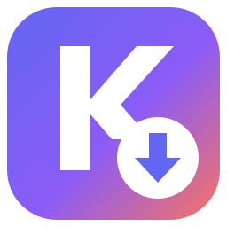
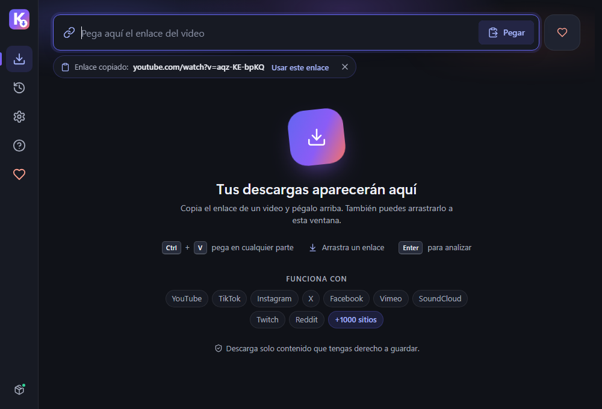
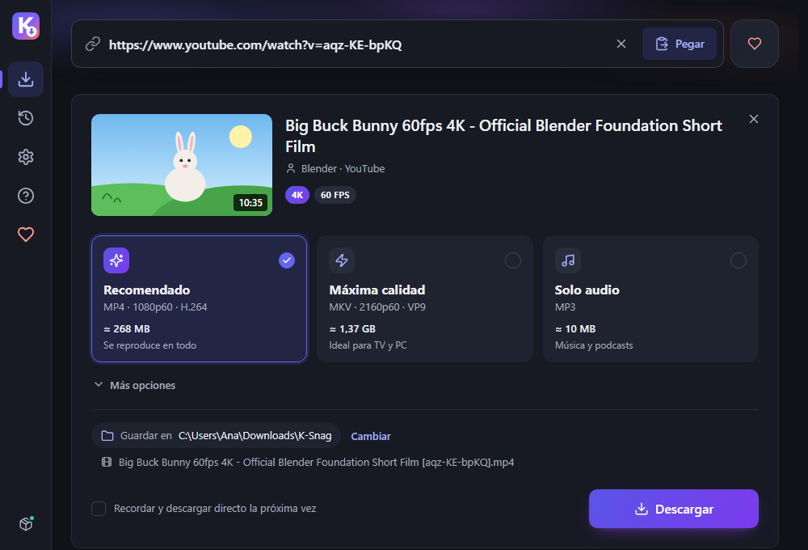
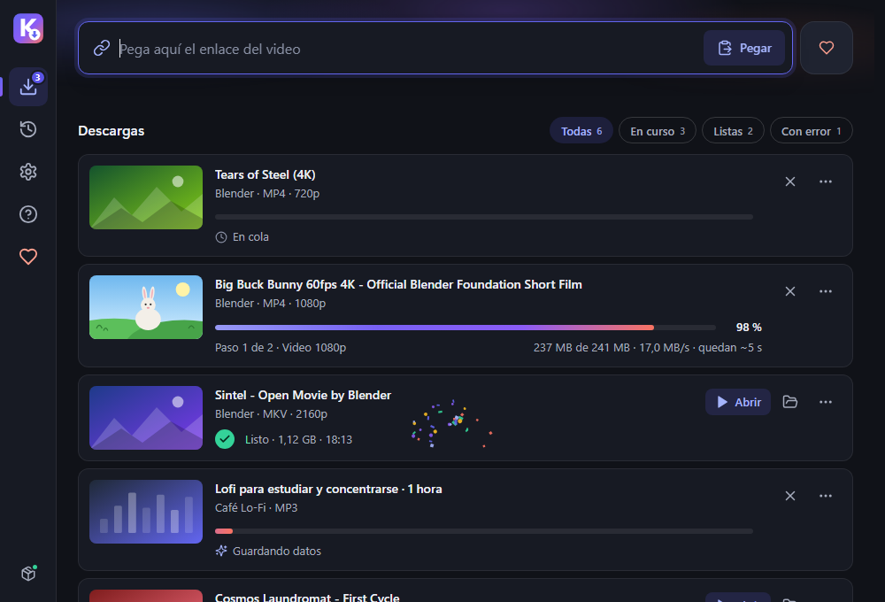

<p align="center">
  
</p>

<h1 align="center">K-Snag</h1>

<p align="center">
  Descarga tus videos favoritos en la mejor calidad, con una app moderna para Windows y Android.<br>
  <sub><a href="#english">Read in English</a></sub>
</p>

<p align="center">
  <a href="https://ksnagapp.vercel.app/descargar"></a>
  <a href="https://ksnagapp.vercel.app/android"></a>
</p>

<p align="center">
  <a href="https://ksnagapp.vercel.app/descargar"><b>Descargar para Windows</b></a> ·
  <a href="https://ksnagapp.vercel.app/android"><b>Descargar para Android</b></a> ·
  <a href="https://github.com/Kasaco223/K-Snag/releases">Todas las versiones</a> ·
  <a href="https://ksnagapp.vercel.app/ayuda">Centro de ayuda</a> ·
  <a href="https://ksnagapp.vercel.app/donar">Apoyar el proyecto</a>
</p>

<p align="center">
  <a href="https://github.com/Kasaco223/K-Snag/releases/latest"></a>
  <a href="https://github.com/Kasaco223/K-Snag/actions/workflows/ci.yml"></a>
  <a href="LICENSE"></a>
</p>

<!-- Capturas: se agregan en docs/screenshots/ (cómo generarlas: docs/screenshots/README.md). -->
<p align="center">
  
  
  
</p>

---

## Qué es K-Snag

K-Snag es una app gratuita y de código abierto para Windows y [Android](#android):

1. Pegas el enlace de un video.
2. Eliges la calidad.
3. Lo tienes en tu carpeta Descargas.

Por dentro usa [yt-dlp](https://github.com/yt-dlp/yt-dlp), el motor de descarga más completo que existe. La app lo mantiene al día sola, para que siga funcionando cuando YouTube cambia algo.

Hasta noviembre de 2026 se llamó **K-Downloader** (Windows 2.0.2 y Android 1.0.2), y antes, "YouTube Ultra HD Video Downloader". La 2.0 es una reconstrucción desde cero. Si ya la tenías instalada, se actualiza sola con el nombre nuevo y conserva tu historial y tus ajustes.

## Funciones

- **Pega y descarga:**
  - pega con `Ctrl+V` en cualquier parte o arrastra el enlace a la ventana;
  - puedes pegar varios enlaces a la vez;
  - si copiaste un enlace, la app te lo sugiere al volver a la ventana.
- **Calidad real, sin sorpresas.** Ves la calidad exacta que vas a bajar y el tamaño aproximado antes de descargar:
  - **Video recomendado:** MP4 hasta 1080p (H.264 + AAC). Se reproduce en cualquier PC, TV o celular.
  - **Máxima calidad:** la mayor resolución disponible, hasta 4K u 8K y 60 fps, en MKV.
  - **Solo audio:** MP3 con portada. En *Más opciones* también hay M4A y resoluciones concretas.
- **Progreso de verdad:**
  - la etapa ("Paso 1 de 2 · Video 1080p", "Uniendo audio y video");
  - la velocidad y el tiempo restante;
  - una cola con hasta 4 descargas simultáneas.
- **Listas de reproducción:** baja solo un video o la lista completa.
- **Errores que se entienden:**
  - un mensaje claro y un botón para resolverlo ("Actualizar y reintentar", "Elegir otra calidad"…);
  - los detalles técnicos se copian con un clic.
- **Se arregla sola:**
  - el motor se actualiza sin reinstalar nada;
  - ante un error típico de YouTube (403), actualiza y reintenta por su cuenta.
- **Historial** con búsqueda: abrir, mostrar en la carpeta, descargar de nuevo y copiar el enlace.
- **Descarga rápida** con tu formato favorito.
- **Desde el navegador:** botón "Abrir en K-Snag" en la web y un marcador para tu barra de favoritos.
- **Español e inglés**, tema claro u oscuro y opción para reducir las animaciones.
- **Otros sitios:** está pensada para YouTube, pero también abre enlaces de muchos sitios compatibles con yt-dlp.

## Cómo funciona

| Pieza | Qué es | De dónde sale |
| --- | --- | --- |
| La app | Interfaz HTML/CSS/JS en una ventana de [pywebview](https://pywebview.flowrl.com/) (WebView2) | Este repositorio |
| Intérprete | **Python oficial** 3.13 *embeddable*, firmado por la Python Software Foundation | python.org, dentro del instalador |
| Motor | **yt-dlp** como *zipapp*: un archivo de Python puro, no un `.exe` | GitHub de yt-dlp. Canal **nightly** por defecto, **estable** opcional |
| Conversor | **FFmpeg** *release essentials* (une audio y video, convierte a MP3) | [gyan.dev](https://www.gyan.dev/ffmpeg/builds/) |
| Componente de YouTube | **Deno**, el entorno de JavaScript que yt-dlp usa para los desafíos de YouTube | GitHub oficial de Deno |

- **Primer uso:** la app descarga los componentes, unos 160 MB, desde sus fuentes oficiales.
  - Comprueba cada archivo con el **SHA-256** que publica su autor.
  - Si un archivo no coincide o no tiene hash publicado, no lo instala.
  - Deno se baja en segundo plano: puedes empezar a descargar antes de que termine.
- **Motor siempre al día:**
  - revisa si hay un yt-dlp nuevo una vez al día y también cuando YouTube devuelve errores;
  - cada versión se instala en su propia carpeta, sin tocar las descargas en curso;
  - conserva la anterior para volver atrás.
- **Arreglos de emergencia:** si YouTube rompe algo, el mantenedor puede publicar una pista en [`engine.json`](engine.json) (por ejemplo, "exigir yt-dlp ≥ X") y todas las instalaciones la reciben sin una versión nueva de la app. Detalles en [docs/engine-hints.md](docs/engine-hints.md).
- **La app también se actualiza:** te avisa cuando hay una versión nueva y, si aceptas, baja solo el código nuevo (~1 MB), verifica su SHA-256 y se reinicia.
- **Para desarrolladores:** la arquitectura completa está en [docs/architecture.md](docs/architecture.md).

## Instalación

**Requisitos:**

- Windows 10 (versión 1803 o posterior) u 11, de 64 bits.
- Unos 400 MB libres y conexión a internet.
- [Microsoft Edge WebView2 Runtime](https://developer.microsoft.com/microsoft-edge/webview2/), que ya viene con Windows 11 y con Windows 10 actualizado.

**Pasos:**

1. Descarga **`Instalar-K-Snag.cmd`** desde <https://ksnagapp.vercel.app/descargar> (o desde [Releases](https://github.com/Kasaco223/K-Snag/releases/latest)).
2. **Si el navegador avisa** que el archivo "no se descarga habitualmente" o "puede dañar tu equipo", elige **Conservar** (*Keep*).
   - En Edge: menú **…** de la descarga → **Conservar** → **Mostrar más** → **Conservar de todos modos**.
3. **Desbloquéalo.** Windows no deja abrir los `.cmd` descargados de internet, y por eso no se abre desde el navegador.
   - Ve a tu carpeta **Descargas**, haz clic derecho en el archivo → **Propiedades** → marca **Desbloquear** → **Aceptar**.
   - **Otra opción:** clic derecho → **Ejecutar como administrador**. También funciona: se instala en tu usuario y abre la app sin permisos de administrador. Si tu cuenta no es de administrador, usa **Desbloquear**, porque Windows te pediría otra cuenta y la app se instalaría para esa cuenta (el instalador lo detecta y te avisa).
4. **Ábrelo con doble clic.** Si aparece *"Windows protegió tu PC"* (SmartScreen), pulsa **Más información** → **Ejecutar de todas formas**.
   - Pasa con todo programa nuevo que todavía no tiene firma digital. Lee [por qué no hay un .exe](#por-qué-no-hay-un-exe).
5. **El instalador:**
   - baja `kd-bundle-<versión>.zip` (unos 25 MB) desde GitHub Releases;
   - comprueba su SHA-256 y lo instala **solo para tu usuario** en `%LOCALAPPDATA%\Programs\K-Downloader`, sin pedir permisos de administrador (la carpeta conserva el nombre anterior para que las instalaciones existentes sigan actualizándose);
   - crea el acceso directo **K-Snag** en el menú Inicio y abre la app.
6. **En el primer uso**, acepta el aviso de uso responsable y espera a que la app prepare sus componentes.

> **¿Es seguro el instalador?** Es un archivo de texto: puedes abrirlo con el Bloc de notas antes de ejecutarlo.
>
> - Solo usa `curl.exe` y `tar.exe`, que vienen con Windows.
> - Se detiene si el SHA-256 del paquete no coincide con el que trae escrito.

**Desinstalar:** Configuración → Aplicaciones → Aplicaciones instaladas → **K-Snag** → **…** → **Desinstalar**.

- Tus videos descargados no se tocan.
- Para borrar también los ajustes, el historial y los componentes del motor, elimina la carpeta `%LOCALAPPDATA%\K-Downloader`.

### Por qué no hay un .exe

Windows 11 trae **Smart App Control**, que bloquea cualquier `.exe` nuevo que no esté firmado o que Microsoft todavía no conozca. Un `.exe` hecho con PyInstaller o un instalador de Inno Setup quedarían bloqueados en esas PC sin dar opción a abrirlos. La firma de código cuesta dinero y la reputación tarda meses.

Por eso K-Snag **no genera ningún ejecutable propio**:

- La app es código Python que corre sobre el `pythonw.exe` **oficial firmado** por la Python Software Foundation.
- yt-dlp corre como *zipapp* de Python puro.
- FFmpeg (de gyan.dev) y Deno (firmado) ya tienen reputación en Windows.
- El instalador es un script `.cmd` que puedes leer.

El resultado funciona incluso con Smart App Control activado. Lo único que Smart App Control frena es abrir el `.cmd` recién descargado, porque viene de internet; por eso existe el paso de **Desbloquear**. Si algún día el proyecto obtiene firma de código (ver la [política de firma](#política-de-firma-de-código)), podría ofrecer un `.exe` firmado.

## Android

**K-Snag para Android** hace lo mismo desde el celular: en YouTube o en cualquier app, toca **Compartir › K-Snag**, elige el formato y el archivo queda en **Descargas › K-Snag**. También puedes pegar el enlace.

- **Formatos:** video MP4 hasta 1080p, máxima calidad en MKV (4K si existe), audio MP3 o M4A, y otras alturas en «Más calidades». Antes de bajar muestra la miniatura, el título y el tamaño real de cada opción.
- **Listas:** se baja la lista entera, hasta 500 videos.
- **Se mantiene sola:** el motor (yt-dlp) se actualiza cuando YouTube cambia, con reintentos automáticos. La app avisa cuando hay una versión nueva y se actualiza con tu confirmación.
- **En segundo plano:** las descargas siguen con la pantalla apagada, se retoman si Android cierra la app y pueden esperar el Wi-Fi.
- **Avance en la notificación:** desde Android 13 la app pide permiso para mostrar notificaciones al empezar la primera descarga. Si lo niegas, la descarga sigue igual y Inicio te ofrece activarlas.

**Instalación:**
1. Entra a **<https://ksnagapp.vercel.app/android>** desde el celular y toca **Descargar APK**.
2. Ábrelo. La primera vez, Android pide **permitir instalar desde esa fuente**: toca **Configuración**, activa el permiso, vuelve y toca **Instalar**.
3. Si Google Play Protect avisa, la página explica cada mensaje.

**Requisitos:** Android 8.0 o superior. El APK de 64 bits (casi todos los celulares) pesa unos 54 MB, el de 32 bits unos 46 MB y el x86_64 unos 57 MB; ya instalada, con su motor, ocupa unos 230 MB. Están todos en [Releases](https://github.com/Kasaco223/K-Snag/releases?q=android&expanded=true) con sus SHA-256.

> Los archivos se siguen llamando `K-Downloader-Android-<abi>.apk`: las versiones 1.0.0 a 1.0.2 solo se actualizan con ese nombre.

**¿Por qué no está en Google Play?** Google Play no acepta apps que descargan videos de YouTube. Las versiones salen de este repositorio, firmadas siempre con la misma llave (certificado SHA-256 `79:F7:78:12:B9:9F:3F:21:39:38:F6:66:3E:7C:00:EF:3D:B8:E1:74:7A:10:C9:81:F2:66:A6:AB:E2:24:F3:1F`).

**Código y licencia:** la app de Android está en [`android/`](android/), con licencia [GPL-3.0-or-later](android/LICENSE), porque incluye FFmpeg y otros componentes GPL. El código fuente de esos binarios está publicado en [android-sources-ytdl-0.18.1-r1](https://github.com/Kasaco223/K-Snag/releases/tag/android-sources-ytdl-0.18.1-r1) y la lista completa, en [android/THIRD_PARTY_NOTICES.md](android/THIRD_PARTY_NOTICES.md). Para compilar y publicar: [android/README.md](android/README.md) y [docs/release-android.md](docs/release-android.md).

## Apoya el proyecto

K-Snag es gratis, sin anuncios ni funciones de pago, y así va a seguir. Si te sirve, puedes apoyarlo en **<https://ksnagapp.vercel.app/donar>**:

- **Desde Colombia:** transferencia con la llave **Bre-B** `@carlose3509` (desde Nequi, Bancolombia, Daviplata o cualquier banco), o PayPal.
- **Desde otro país:** PayPal (tarjeta o cuenta, una vez, cada mes o cada año) o cripto (APT, solo por la red Aptos).

Donar es voluntario y no desbloquea nada. También ayuda dejar una estrella en GitHub, [reportar errores](https://github.com/Kasaco223/K-Snag/issues/new/choose) o compartir la app. La app tiene un botón **Apoyar el proyecto** en la barra lateral (Windows) y **Donar** en la barra de abajo (Android).

## Preguntas frecuentes y solución de problemas

<details>
<summary><b>¿K-Downloader y K-Snag son la misma app?</b></summary>

Sí. La app cambió de nombre en noviembre de 2026 porque ya existía otra app llamada K-Downloader. Se actualiza encima, sin perder el historial ni los ajustes, y la web anterior (kdownloader.vercel.app) lleva a la nueva.

Por compatibilidad, algunas cosas internas conservan el nombre anterior: en Windows, las carpetas `%LOCALAPPDATA%\K-Downloader` y `Programs\K-Downloader`; en Android, el paquete `io.github.kasaco223.kdownloader` y los archivos APK.

</details>

<details>
<summary><b>Me sale "Error 403" o "YouTube cambió algo"</b></summary>

YouTube cambia su sitio a menudo y eso rompe a todos los descargadores por un tiempo.

- La app **actualiza el motor y reintenta sola**.
- Si el error sigue, todavía no hay arreglo: espera unas horas. En cuanto yt-dlp publique la corrección, la app la instalará sola.
- También puedes forzarlo en **Ajustes → Componentes → Actualizar**.

</details>

<details>
<summary><b>Los videos "para niños" tardan más</b></summary>

YouTube entrega los videos marcados como "para niños" con más restricciones, así que el análisis y la descarga pueden ser más lentos. Es normal: dale unos segundos más.

</details>

<details>
<summary><b>Los videos para mayores de 18 solo bajan en 360p</b></summary>

Hoy, sin una sesión iniciada, YouTube solo entrega esos videos en 360p. La app te avisa antes de descargar.

Puedes intentarlo con un `cookies.txt` de una cuenta verificada en **Ajustes → Avanzado**, con los riesgos de la siguiente pregunta.

</details>

<details>
<summary><b>¿Debo usar cookies?</b></summary>

Casi nunca. Solo hacen falta para contenido que exige una cuenta (privado, de miembros o para mayores de 18).

- **Riesgo:** usar tu cuenta con un descargador puede hacer que YouTube la marque o la suspenda. Si lo haces, usa una cuenta secundaria.
- **Un `cookies.txt` equivale a tu sesión:** quien lo tenga entra a tu cuenta. Nunca lo compartas ni lo subas a un issue.
- K-Snag no usa cookies con YouTube salvo que tú lo pidas: con cookies, YouTube ofrece menos calidades.

</details>

<details>
<summary><b>¿Por qué no puedo usar las cookies de Chrome o Edge directamente?</b></summary>

En Windows, Chrome y Edge cifran sus cookies de forma que solo el propio navegador puede leerlas, y además bloquean el archivo mientras están abiertos. Ningún programa externo puede tomarlas de forma confiable.

Si de verdad necesitas una cuenta, exporta un archivo `cookies.txt` (formato Netscape) con una extensión de confianza y elígelo en **Ajustes → Avanzado**.

</details>

<details>
<summary><b>"Demasiadas descargas seguidas" o "comprueba que no eres un robot"</b></summary>

YouTube frena por un rato las conexiones que bajan mucho seguido, sobre todo con VPN o redes compartidas.

- La app activa el **modo tranquilo** (más pausa entre descargas).
- Espera unos minutos y, si usas VPN, desactívala.

</details>

<details>
<summary><b>Windows bloqueó un componente, o el antivirus lo borró</b></summary>

La app lo detecta y ofrece **Reparar**: vuelve a bajar el componente desde su fuente oficial y verifica su SHA-256.

Si tu antivirus lo vuelve a borrar, es un falso positivo: repórtalo a su fabricante.

</details>

<details>
<summary><b>¿Dónde quedan mis archivos y los registros?</b></summary>

| Qué | Dónde |
| --- | --- |
| Videos (Windows) | `Descargas\K-Snag` (se cambia en Ajustes). Si ya tenías `Descargas\K-Downloader`, la app sigue usando esa. |
| Videos (Android) | **Descargas › K-Snag**. Las descargas de antes del cambio de nombre siguen en Descargas › K-Downloader. |
| Ajustes, historial y componentes (Windows) | `%LOCALAPPDATA%\K-Downloader` |
| Registro de la app (Windows, para reportar errores) | `%LOCALAPPDATA%\K-Downloader\logs\app.log` |
| Diagnóstico (Android) | **Ajustes › Acerca de K-Snag › Diagnóstico › Copiar detalles** |

</details>

¿No está tu problema? Revisa el [centro de ayuda](https://ksnagapp.vercel.app/ayuda) o [abre un issue](https://github.com/Kasaco223/K-Snag/issues/new/choose).

## Privacidad

K-Snag **no tiene telemetría**: no envía estadísticas, no tiene cuentas ni anuncios y no rastrea qué descargas. Solo se conecta a:

| Destino | Para qué |
| --- | --- |
| GitHub | Revisar si hay una versión nueva de la app y leer las pistas del motor (`engine.json`), una vez al día. Bajar yt-dlp y Deno. |
| gyan.dev | Bajar FFmpeg. |
| Los sitios de los enlaces que pegas | Analizar y descargar el video, como haría tu navegador. |
| ksnagapp.vercel.app (solo Android) | Respaldo para revisar si hay una versión nueva cuando GitHub no responde. Las páginas de ayuda y de donaciones solo se abren si tú las tocas. |

- Puedes apagar la búsqueda de actualizaciones de la app y del motor en **Ajustes**.
- Los registros y el historial se quedan en tu PC.
- Si usas un `cookies.txt`, solo lo lee yt-dlp en tu equipo.

## Uso responsable

Descarga solo contenido que tengas derecho a guardar: el tuyo, el que tiene una licencia que lo permite o el que la ley de tu país te deja copiar para uso personal. Respeta a los creadores y los términos de cada sitio.

K-Snag **no evade protecciones** (DRM), no baja contenido de pago y no ayuda a saltarse bloqueos regionales. Más en <https://ksnagapp.vercel.app/uso-responsable>.

## Desarrollo

Necesitas Windows 10 u 11 y Python 3.11 o posterior. La app distribuida corre en Python 3.13; el CI prueba ambas versiones.

```powershell
git clone https://github.com/Kasaco223/K-Snag.git
cd K-Snag
python -m venv .venv
.venv\Scripts\pip install -e ".[dev]"
.venv\Scripts\python -m kdownloader
```

> En desarrollo, la app usa la misma carpeta de datos que la versión instalada. Para separarlas: `$env:KD_DATA_DIR = "$env:TEMP\kd-dev"`.

**Ver la interfaz sin Python (modo simulado):**

```powershell
cd src\kdownloader\ui
python -m http.server 8000
```

Abre <http://localhost:8000/index.html?mock=1&scenario=S4>.

- `scenario` va de `S0` a `S9`:
  - S0 bienvenida, S1 inicio, S2 analizando, S3 formato, S4 descargas;
  - S5 listo, S6 error, S7 historial, S8 ajustes, S9 ayuda.
- Agrega `&theme=light` o `&theme=dark` y `&lang=es` o `&lang=en`.

| Carpeta | Contenido |
| --- | --- |
| `src/kdownloader/` | Backend en Python: ventana, puente con la UI, cola, historial, actualizaciones |
| `src/kdownloader/engine/` | Motor: componentes, procesos, presets, progreso, errores, pistas |
| `src/kdownloader/ui/` | Interfaz HTML/CSS/JS, sin build ni frameworks |
| `packaging/` | Build del bundle e instalador `.cmd` |
| `android/` | App de Android (Kotlin y Jetpack Compose, GPL-3.0-or-later): guía en [android/README.md](android/README.md) |
| `web/` | Sitio estático (ksnagapp.vercel.app), sin build |
| `tests/` | Pruebas con pytest |
| `docs/` | Arquitectura, publicación y pistas del motor |
| `.github/` | Workflows de CI y de publicación, y plantillas de issues |

**App de Android:** se compila con Docker, sin instalar el SDK en tu PC (detalles en [android/README.md](android/README.md)):

```powershell
docker compose -f android/tools/docker/compose.yaml build
docker compose -f android/tools/docker/compose.yaml run --rm kdl :app:assembleGithubDebug -Pkdl.devAbi=arm64-v8a
docker compose -f android/tools/docker/compose.yaml run --rm kdl :core:test :app:testGithubDebugUnitTest :app:lintGithubDebug
```

Cómo colaborar: [CONTRIBUTING.md](CONTRIBUTING.md).

### Pruebas

```powershell
.venv\Scripts\ruff check src tests
.venv\Scripts\pytest              # unitarias, sin red (las que corre el CI)
.venv\Scripts\pytest -m network   # motor real: usa internet, yt-dlp y FFmpeg
```

### Compilar

```powershell
powershell -ExecutionPolicy Bypass -File packaging\build.ps1
```

Deja en `dist/`:

- `Instalar-K-Snag.cmd` y su copia `Instalar-K-Downloader.cmd` (el nombre anterior, para los enlaces viejos)
- `kd-bundle-<versión>.zip`
- `kd-app-<versión>.zip`
- `latest.json`
- `SHA256SUMS.txt`

Opciones: `-Version`, `-BaseUrl`, `-OutDir` y `-SkipTests`. No compila ningún `.exe`.

Para probar la instalación sin publicar:

```powershell
.\dist\Instalar-K-Snag.cmd --local "$PWD\dist\kd-bundle-<versión>.zip" --root "$env:TEMP\kd-prueba" --no-registry
```

### Publicar una versión

1. Sube `__version__` en `src/kdownloader/__init__.py`.
2. Haz merge a `master` y sube el tag `vX.Y.Z`.
3. GitHub Actions construye, prueba la instalación en limpio y deja el Release en borrador para revisarlo y publicarlo.

Checklist completa: [docs/release.md](docs/release.md). La app de Android se publica con su propio tag `android-vX.Y.Z`, con aprobación manual de la firma: [docs/release-android.md](docs/release-android.md).

## Política de firma de código

> **Estado: K-Snag todavía no está firmado.** Esta política se prepara para postular al programa de firma gratuita para código abierto de [SignPath Foundation](https://signpath.org/). Cuando sea aceptado, esta sección dirá: *"Free code signing provided by [SignPath.io](https://about.signpath.io/), certificate by [SignPath Foundation](https://signpath.org/)"*.

**Qué se firmaría:**

- solo los archivos que **GitHub Actions construye desde este repositorio público** con el workflow [`release.yml`](.github/workflows/release.yml), a partir de un tag `vX.Y.Z`;
- nunca se firman builds hechos en una PC personal;
- nunca se firman programas de terceros (Python, yt-dlp, FFmpeg, Deno): se usan tal como los publican sus autores.

**Roles:**

| Rol | Persona |
| --- | --- |
| Autor (*committer*) | [Kasaco223](https://github.com/Kasaco223) |
| Revisor (*reviewer*) | [Kasaco223](https://github.com/Kasaco223) |
| Aprobador de cada firma (*approver*) | [Kasaco223](https://github.com/Kasaco223) |

**Reglas:**

- Todo cambio entra a `master` por pull request con el CI en verde.
- Las dependencias del runtime están fijadas con versión y SHA-256 en `packaging/requirements-runtime.txt`.
- Las cuentas de GitHub y de SignPath del equipo usan verificación en dos pasos.

**Privacidad:** este programa no envía información a otros sistemas en red, salvo lo que pide quien lo usa (analizar y descargar los enlaces que pega) y lo que se describe en [Privacidad](#privacidad): búsqueda de actualizaciones de la app y del motor y descarga de sus componentes, que se pueden desactivar en Ajustes.

## Créditos

K-Snag existe gracias a:

- [yt-dlp](https://github.com/yt-dlp/yt-dlp), el motor de descarga.
- [FFmpeg](https://ffmpeg.org/), con los builds de [gyan.dev](https://www.gyan.dev/ffmpeg/builds/).
- [Deno](https://deno.com/).
- [pywebview](https://pywebview.flowrl.com/) y [pythonnet](https://pythonnet.github.io/).
- [Python](https://www.python.org/) y la Python Software Foundation.
- Los íconos de [Lucide](https://lucide.dev/).

Lista completa de componentes y licencias: [THIRD_PARTY_NOTICES.md](THIRD_PARTY_NOTICES.md).

## Licencia

- **App de Windows:** [MIT](LICENSE).
- **App de Android** (carpeta `android/`): [GPL-3.0-or-later](android/LICENSE).

Los componentes de terceros conservan sus propias licencias ([THIRD_PARTY_NOTICES.md](THIRD_PARTY_NOTICES.md) y [android/THIRD_PARTY_NOTICES.md](android/THIRD_PARTY_NOTICES.md)).

## Aviso

K-Snag es un proyecto independiente. **No está afiliado a YouTube ni a Google**, ni cuenta con su respaldo. YouTube, Android y Google Play son marcas de Google LLC; Windows es una marca de Microsoft Corporation. Cada persona es responsable de cómo usa la app.

---

## English

**K-Snag** is a free, open-source app for Windows and [Android](#android-1) to download your favorite videos in the best quality:

1. Paste a link.
2. Pick a quality.
3. The file lands in your Downloads folder.

It is powered by [yt-dlp](https://github.com/yt-dlp/yt-dlp) and keeps it up to date by itself, so it keeps working when YouTube changes things. Until November 2026 it was called **K-Downloader** (Windows 2.0.2, Android 1.0.2), and before that "YouTube Ultra HD Video Downloader"; 2.0 is a full rebuild. Existing installs update in place under the new name and keep their history and settings.

**[Download for Windows](https://ksnagapp.vercel.app/descargar)** · **[Download for Android](https://ksnagapp.vercel.app/android)** · [All releases](https://github.com/Kasaco223/K-Snag/releases) · [Help center](https://ksnagapp.vercel.app/ayuda) · [Support the project](https://ksnagapp.vercel.app/donar)

### Features

- **Paste and go:** `Ctrl+V` anywhere, drag and drop, several links at once, and a clipboard suggestion.
- **Real quality before you download,** with an approximate size:
  - **Recommended:** MP4 up to 1080p (H.264 + AAC), plays everywhere.
  - **Max quality:** up to 4K/8K at 60 fps, in MKV.
  - **Audio only:** MP3 with cover art. M4A and specific resolutions are under *More options*.
- **Real progress:** step, speed and time left, with a queue of up to 4 parallel downloads. Playlists are supported.
- **Errors you can understand:** a clear message and a one-click fix.
- **Self-healing:** on a typical YouTube 403 error, it updates the engine and retries.
- **Also included:**
  - history with search;
  - quick download with your favorite format;
  - "Open in K-Snag" from the browser;
  - Spanish and English, light and dark themes.

### How it works

- **The app:** HTML/CSS/JS UI in a [pywebview](https://pywebview.flowrl.com/) window (WebView2), running on the **official, signed Python 3.13 embeddable** distribution.
- **yt-dlp:** runs as a pure-Python **zipapp**, from the **nightly** channel by default (stable is optional). It updates itself daily and whenever YouTube starts failing.
- **FFmpeg:** *release essentials* builds from **gyan.dev**.
- **Deno:** the official build, used for YouTube's JavaScript challenges.
- **First run:** the components (about 160 MB) are downloaded from their upstream sources.
  - Each one is verified against its published **SHA-256**.
  - Nothing without a published hash is installed.
- **Emergency hints:** the maintainer can push hints through [`engine.json`](engine.json) without a new app release. See [docs/engine-hints.md](docs/engine-hints.md).

### Installation

1. Download **`Instalar-K-Snag.cmd`** from <https://ksnagapp.vercel.app/descargar>.
2. If your browser warns that the file is uncommon or may be harmful, choose **Keep**.
3. **Unblock it.** Windows won't open `.cmd` files downloaded from the internet, so it won't start from the browser. In your **Downloads** folder, right-click it → **Properties** → check **Unblock** → **OK**.
   - **Alternative:** right-click → **Run as administrator**. It still installs for your user and opens the app without admin rights. If your account is not an administrator, use **Unblock** instead: Windows would ask for another account and the app would be installed for that account (the installer detects this and tells you).
4. Double-click it. If SmartScreen shows *"Windows protected your PC"*, click **More info → Run anyway**.
5. **What the installer does:**
   - downloads `kd-bundle-<version>.zip` (about 25 MB) from GitHub Releases;
   - verifies its SHA-256;
   - installs **for your user only** in `%LOCALAPPDATA%\Programs\K-Downloader` (no admin rights needed; the folder keeps the former name so existing installs keep updating);
   - creates a **K-Snag** Start menu shortcut.

**Requirements:** Windows 10 (1803+) or 11, 64-bit, with the WebView2 Runtime.

**Uninstall:** Settings → Apps → Installed apps → **K-Snag** → **Uninstall**.

- Your downloaded videos are kept.
- To remove settings, history and engine components as well, delete `%LOCALAPPDATA%\K-Downloader`.

**Why there is no .exe.** Windows 11 **Smart App Control** blocks new executables that are unsigned or not yet known to Microsoft. So K-Snag ships no executable of its own:

- the app runs on Python's official signed `pythonw.exe`;
- yt-dlp is a Python zipapp;
- FFmpeg and Deno already have reputation;
- the installer is a readable `.cmd` script. Smart App Control only blocks opening it right after download, because it comes from the internet; that is what the **Unblock** step is for.

### Android

**K-Snag for Android** does the same on your phone: in YouTube or any other app, tap **Share › K-Snag**, pick the format and the file lands in **Downloads › K-Snag**. You can also paste the link.

- **Formats:** MP4 up to 1080p, best quality in MKV, MP3 or M4A audio, plus other heights under "More qualities", with the real size of each option before downloading. Playlists of up to 500 videos.
- **Keeps itself working:** the engine (yt-dlp) updates when YouTube changes, with automatic retries; the app tells you about new versions and updates with your confirmation.
- **Background:** downloads keep going with the screen off, resume if Android closes the app and can wait for Wi-Fi.
- **Progress notification:** on Android 13+ the app asks for the notification permission when your first download starts. If you deny it, downloads work the same and Home offers to turn notifications on.

**Install:** open **<https://ksnagapp.vercel.app/android>** on your phone, tap **Download APK**, open it and allow installing from that source the first time. Requires Android 8.0+. The 64-bit APK is about 54 MB. The files are still named `K-Downloader-Android-<abi>.apk`, because versions 1.0.0–1.0.2 only update from that name.

**Why not Google Play?** Google Play doesn't accept apps that download YouTube videos. Every release comes from this repository, always signed with the same key (certificate SHA-256 `79:F7:78:12:B9:9F:3F:21:39:38:F6:66:3E:7C:00:EF:3D:B8:E1:74:7A:10:C9:81:F2:66:A6:AB:E2:24:F3:1F`).

**Code and license:** the Android app lives in [`android/`](android/) under [GPL-3.0-or-later](android/LICENSE); the source of its GPL binaries is published at [android-sources-ytdl-0.18.1-r1](https://github.com/Kasaco223/K-Snag/releases/tag/android-sources-ytdl-0.18.1-r1).

### Support the project

K-Snag is free, with no ads or paid features. If it helps you, you can support it at **<https://ksnagapp.vercel.app/donar>**: PayPal (card or account; one-time, monthly or yearly) or crypto (APT, Aptos network only). From Colombia you can also use **Bre-B** (`@carlose3509`). Donating is optional and unlocks nothing.

### FAQ

- **Are K-Downloader and K-Snag the same app?** Yes. It was renamed in November 2026 because another app already used the name. It updates in place; some internals keep the old name for compatibility (the Windows folders `%LOCALAPPDATA%\K-Downloader` and `Programs\K-Downloader`, the Android package and the APK file names).

- **"403" or "YouTube changed something":** the app updates the engine and retries. If it persists, wait for a yt-dlp fix: the app installs it automatically.
- **"Made for kids" videos are slower:** YouTube serves them with more restrictions.
- **Age-restricted videos only download in 360p today** without a signed-in session.
- **Cookies:**
  - Using your account with a downloader may get it flagged. Use a secondary account.
  - Never share a `cookies.txt`: it is your session.
  - Chrome and Edge cookies cannot be read by external tools on Windows. Export a Netscape `cookies.txt` instead and pick it in **Settings → Advanced**.
- **Where files go:** Windows saves to `Downloads\K-Snag` (or `Downloads\K-Downloader` if you already had it); Android saves to **Downloads › K-Snag**.
- **Logs:** Windows `%LOCALAPPDATA%\K-Downloader\logs\app.log`; Android **Settings › About K-Snag › Diagnostics › Copy details**.

### Privacy

No telemetry, no accounts, no ads. The app only connects to:

- GitHub, once a day, for app updates, engine hints, yt-dlp and Deno;
- gyan.dev for FFmpeg;
- the sites whose links you paste;
- ksnagapp.vercel.app (Android only), as a fallback for update checks.

Update checks can be turned off in Settings.

### Responsible use

Only download content you have the right to keep. K-Snag does not bypass DRM, does not download paid content and does not help get around regional blocks.

### Development

```powershell
python -m venv .venv
.venv\Scripts\pip install -e ".[dev]"
.venv\Scripts\python -m kdownloader
```

**UI preview without Python:** run `python -m http.server 8000` inside `src\kdownloader\ui`, then open `http://localhost:8000/index.html?mock=1&scenario=S4`. Scenarios go from `S0` to `S9`; you can add `&theme=` and `&lang=`.

- **Tests:**
  - `pytest` runs the unit tests (offline);
  - `pytest -m network` uses the real engine.
- **Build:** `packaging\build.ps1` writes everything to `dist/`.
- **Android:** builds with Docker, no local SDK needed. See [android/README.md](android/README.md).
- **Releases:** push a `vX.Y.Z` tag (Windows) or `android-vX.Y.Z` (Android). GitHub Actions builds, tests and drafts the release. See [docs/release.md](docs/release.md), [docs/release-android.md](docs/release-android.md) and [CONTRIBUTING.md](CONTRIBUTING.md).

### Code signing policy

> **Status: K-Snag is not code-signed yet.** This policy is prepared for the [SignPath Foundation](https://signpath.org/) open-source program. Once accepted, this section will read: *"Free code signing provided by [SignPath.io](https://about.signpath.io/), certificate by [SignPath Foundation](https://signpath.org/)"*.

**What gets signed:** only artifacts built by GitHub Actions from this public repository by [`release.yml`](.github/workflows/release.yml), from a `vX.Y.Z` tag.

- Local builds are never signed.
- Third-party programs (Python, yt-dlp, FFmpeg, Deno) are never signed by this project.

**Roles:**

- Committer: [Kasaco223](https://github.com/Kasaco223)
- Reviewer: [Kasaco223](https://github.com/Kasaco223)
- Approver: [Kasaco223](https://github.com/Kasaco223)

**Rules:**

- Every change reaches `master` through a pull request with green CI.
- Runtime dependencies are pinned by version and SHA-256.
- Team accounts use multi-factor authentication.

**Privacy:** this program will not transfer any information to other networked systems unless specifically requested by the user or the person installing or operating it. The only exceptions are the update checks and component downloads described under [Privacy](#privacy), which can be disabled in Settings.

### Credits, license and disclaimer

- **Credits:** [yt-dlp](https://github.com/yt-dlp/yt-dlp), [FFmpeg](https://ffmpeg.org/) (builds by [gyan.dev](https://www.gyan.dev/ffmpeg/builds/)), [Deno](https://deno.com/), [pywebview](https://pywebview.flowrl.com/), [pythonnet](https://pythonnet.github.io/), [Python](https://www.python.org/) and [Lucide](https://lucide.dev/) icons. The full list is in [THIRD_PARTY_NOTICES.md](THIRD_PARTY_NOTICES.md).
- **License:** Windows app [MIT](LICENSE); Android app (`android/`) [GPL-3.0-or-later](android/LICENSE).
- **Disclaimer:** K-Snag is an independent project and is **not affiliated with YouTube or Google**. YouTube, Android and Google Play are trademarks of Google LLC; Windows is a trademark of Microsoft Corporation.
